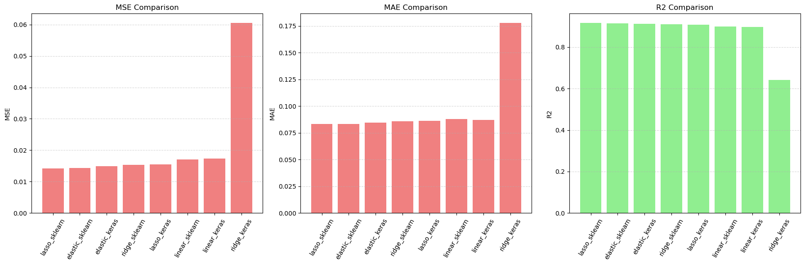

# Regression Models Comparison

This project presents a comprehensive benchmark of four regression algorithms implemented using both **analytical (closed-form)** and **numerical (gradient descent)** approaches — evaluated on the *House Prices: Advanced Regression Techniques* dataset. The pipeline includes robust preprocessing, categorical encoding, model training, and rigorous performance assessment.

---

## Results and Interpretation

- **Ridge Regression**: Reduces variance and mitigates overfitting via L2 regularization.  
- **Lasso Regression**: Promotes sparsity and performs implicit feature selection via L1 regularization.  
- **Elastic Net**: Combines L1 and L2 penalties, balancing bias-variance trade-offs — achieves top performance.  
- **Analytical vs. Numerical**:  
  - *Analytical (scikit-learn)*: Fast and stable for moderate-scale problems.  
  - *Numerical (Keras)*: Flexible and scalable, but sensitive to hyperparameter tuning (learning rate, epochs, optimizer).

| Model                          | R²       | MAE   | RMSE    | Kaggle Score | Overfitting | Notes |
|--------------------------------|----------|-------|---------|--------------|-------------|-------|
| Linear Regression (scikit-learn) | 0.87–0.89 | ~0.19 | 0.25691 | 0.25691      | Slight      | Reliable baseline; captures linear structure effectively |
| Linear Regression (Keras)        | ~0.63    | ~0.28 | 0.33366 | 0.33366      | Severe      | Underfitting; suboptimal convergence due to learning rate/epoch settings |
| Ridge Regression (scikit-learn)  | ~0.85    | ~0.20 | 0.17050 | 0.17050      | Minimal     | Improved stability via L2; modest gains over baseline |
| Ridge Regression (Keras)         | ~0.63    | ~0.27 | 0.24580 | 0.24580      | Underfitting | Requires careful hyperparameter tuning |
| Lasso Regression (scikit-learn)  | ~0.89    | ~0.17 | 0.13459 | 0.13459      | Low         | Strong feature selection; excellent generalization |
| Lasso Regression (Keras)         | ~0.89    | ~0.17 | 0.15724 | 0.15724      | Low         | Competitive, but slightly inferior to scikit-learn counterpart |
| ElasticNet (scikit-learn)        | ~0.89    | ~0.17 | 0.13396 | 0.13396      | Very low    | Optimal balance of L1/L2; best overall performer |
| ElasticNet (Keras)               | ~0.89    | ~0.17 | 0.14579 | 0.14579      | Low         | Solid, yet marginally behind analytical implementation |
---

## Project Overview

The implementation demonstrates:

- End-to-end processing of heterogeneous housing data (numerical, nominal, ordinal)  
- Comparative study of four regression methods:  
  1. Linear Regression  
  2. Ridge (L2 regularization)  
  3. Lasso (L1 regularization)  
  4. Elastic Net (combined L1 + L2)  
- Dual implementations:  
  - *Analytical*: Using scikit-learn’s optimized solvers  
  - *Numerical*: Using TensorFlow/Keras with gradient-based optimization  
- Quantitative evaluation via standard regression metrics and coefficient analysis



---

## Project Structure

```
project_root/
├── data/
│   ├── train.csv
│   └── test.csv
├── notebooks/
│   ├── 01_eda.ipynb
│   └── 02_regression.ipynb
├── requirements.txt
└── README.md
```

---

## Dataset

- **Source**: [Kaggle – House Prices: Advanced Regression Techniques](https://www.kaggle.com/competitions/house-prices-advanced-regression-techniques)  
- **Target**: `SalePrice` (log-transformed in preprocessing)  
- **Features**:  
  - *Nominal categorical*: e.g., Neighborhood, Street  
  - *Ordinal categorical*: e.g., OverallQual, KitchenQual  
  - *Numerical*: e.g., GrLivArea, GarageArea

---

## Preprocessing Pipeline

- **Feature categorization & encoding**:  
  - Nominal → one-hot encoding  
  - Ordinal → integer mapping based on semantic order  
  - Numerical → used directly, then standardized  
- **Scaling**: `StandardScaler` applied to ensure numerical stability in gradient-based training.

---

## Model Implementations

Each algorithm is realized in two variants:

| Algorithm         | Analytical (scikit-learn)       | Numerical (Keras)                        |
|-------------------|----------------------------------|------------------------------------------|
| Linear Regression | `LinearRegression()`            | Dense layer, Adam optimizer, MSE loss   |
| Ridge             | `Ridge(alpha=λ)`                | `kernel_regularizer=l2(λ)`              |
| Lasso             | `Lasso(alpha=λ)`                | `kernel_regularizer=l1(λ)`              |
| Elastic Net       | `ElasticNet(alpha=λ, l1_ratio=r)` | `kernel_regularizer=l1_l2(l1=λ·r, l2=λ·(1−r))` |

---

## Evaluation Metrics

- **R² Score**: Proportion of target variance explained  
- **MAE (Mean Absolute Error)**: Average magnitude of prediction errors  
- **RMSE (Root Mean Squared Error)**: Emphasizes larger errors  
- Cross-implementation comparison of coefficients and training behavior

---