# Untitled

**American Society for Quality**

Ridge Regression: Biased Estimation for Nonorthogonal Problems Author(s): Arthur E. Hoerl and Robert W. Kennard

Reviewed work(s):

Source: Technb., 19

Published by and Stable URL: .

Accessed: 20/02/2013 08:38

ce of the Terms & Conditions of Use, available at .

.

JSTOR is a not-for-profit service that helps scholars, researchers, and students discover, use, and build upon a wide range of content in a trusted digital archive. We use information technology and tools to increase productivity and facilitate new forms of scholarship. For more information about JSTOR, please contact support@jstor.org.

.

*American Statistical Association* and *American Society for Quality* are collaborating with JSTOR to digitize, preserve and extend access to *Technometrics.*

http://www.jstor.org

This content downloaded25 AM

All use subject to

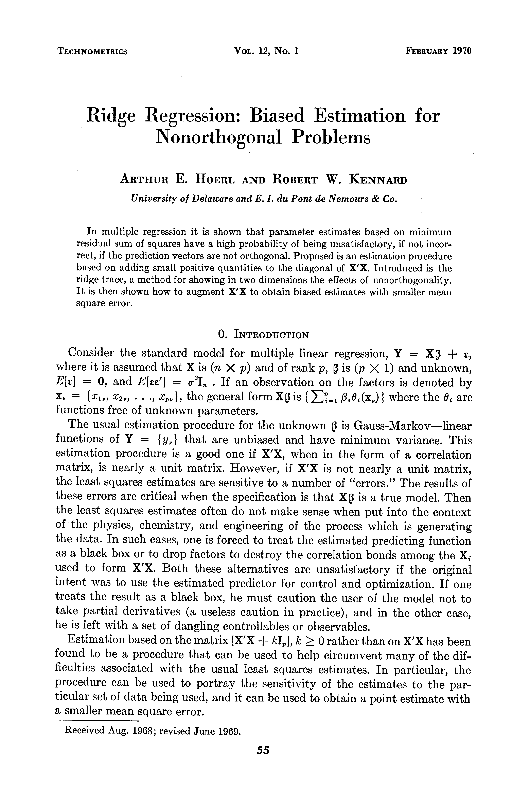

**VOL. 12, No. 1**

**ARTHUR E. HOERL AND ROBERT W. KENNARD**

**University of Delaware and E. 1. du Pont de Nemours & Co.**

**In multiple regression it is shown that parameter estimates based on minimum residual sum of squares have a high probability of being unsatisfactory, if not incor- rect, if the prediction vectors are not orthogonal. Proposed is an estimation procedure based on adding small positive quantities to the diagonal of X'X. Introduced is the ridge trace, a method for showing in two dimensions the effects of nonorthogonality. It is then shown how to augment X'X to obtain biased estimates with smaller mean square error.**

**Consider the standard model for multiple linear regression, Y = X** **+ ~,**

**functions free of unknown parameters.**

**functions of Y = {y,} that are unbiased and have minimum variance. This estimation procedure is a good one if X'X, when in the form of a correlation matrix, is nearly a unit matrix. However, if X'X is not nearly a unit matrix, the least squares estimates are sensitive to a number of "errors." The results of these errors are critical when the specification is that X( is a true model. Then the least squares estimates often do not make sense when put into the context of the physics, chemistry, and engineering of the process which is generating the data. In such cases, one is forced to treat the estimated predicting function as a black box or to drop factors to destroy the correlation bonds among the Xi used to form X'X. Both these alternatives are unsatisfactory if the original intent was to use the estimated predictor for control and optimization. If one treats the result as a black box, he must caution the user of the model not to take partial derivatives (a useless caution in practice), and in the other case, he is left with a set of dangling controllables or observables.**

**Estimation based on the matrix [X'X + kI], k > 0 rather than on X'X has been found to be a procedure that can be used to help circumvent many of the dif- ficulties associated with the usual least squares estimates. In particular, the procedure can be used to portray the sensitivity of the estimates to the par- ticular set of data being used, and it can be used to obtain a point estimate with a smaller mean square error.**

**Received Aug. 1968; revised June 1969.**

This content downloaded25 AM

All use subject to

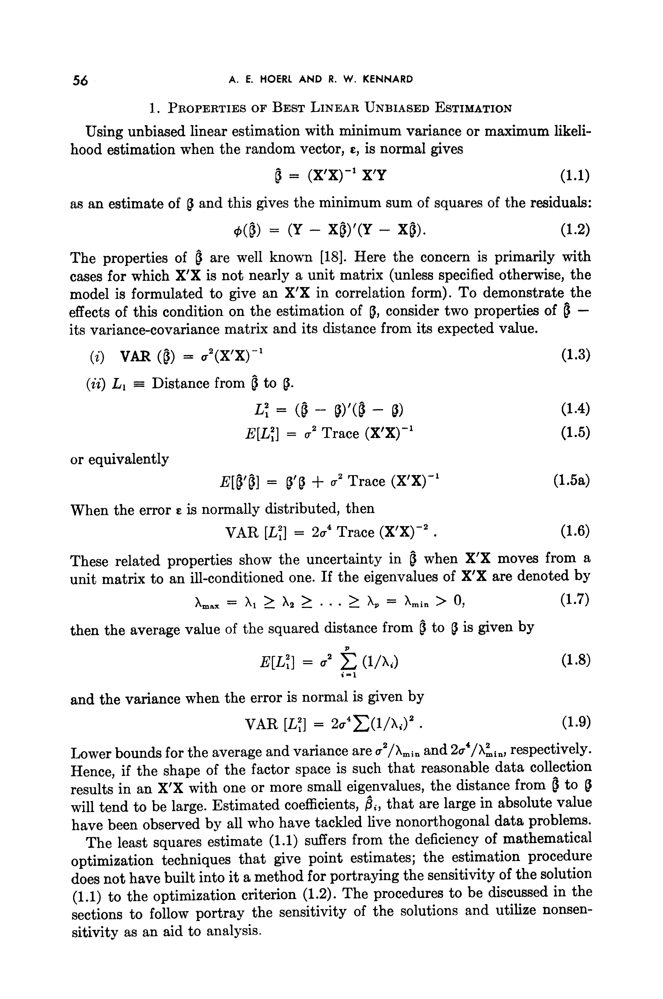

**A. E. HOERL AND R. W. KENNARD**

**have been observed by all who have tackled live nonorthogonal data problems.**

**The least squares estimate (1.1) suffers from the deficiency of mathematical**

**sections to follow portray the sensitivity of the solutions and utilize nonsen-**

This content downloaded25 AM

All use subject to

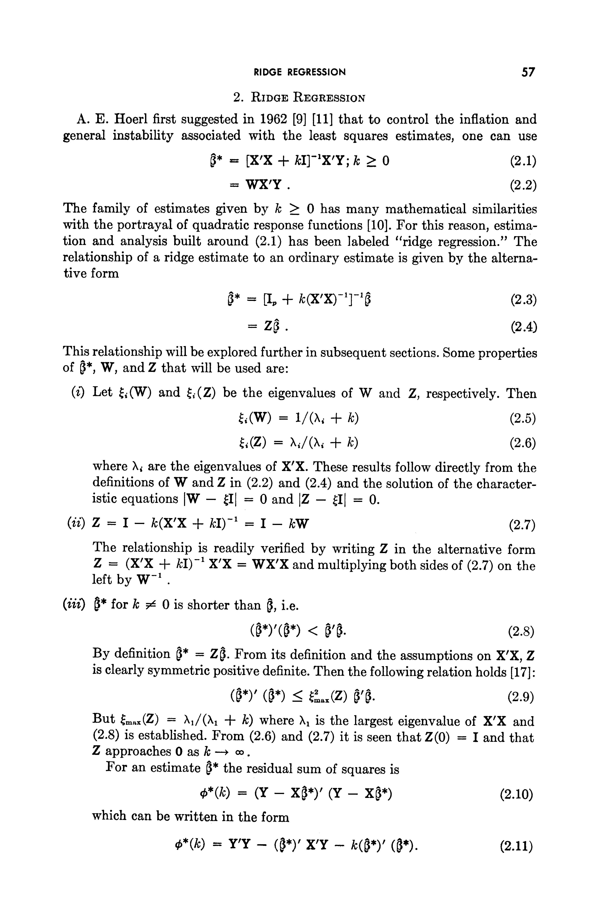

**2. RIDGE REGRESSION**

**A. E. Hoerl first suggested in 1962 [9] [11] that to control the inflation and general instability associated with the least squares estimates, one can use**

**This relationship will be explored further in subsequent sections. Some properties of (*, W, and Z that will be used are:**

**The relationship is readily verified by writing Z in the alternative form**

**left by W-1 .**

**(2.8) is established. From (2.6) and (2.7) it is seen that Z(0) = I and that Z approaches 0 as k -> oo.**

**For an estimate P* the residual sum of squares is**

**which can be written in the form**

This content downloaded25 AM

All use subject to

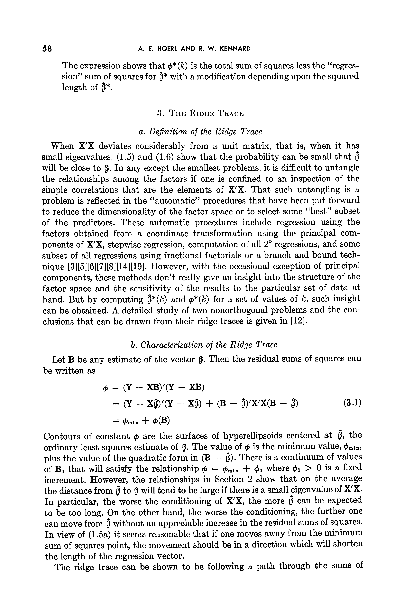

**A. E. HOERL AND R. W. KENNARD**

**3. THE RIDGE TRACE**

**a. Definition of the Ridge Trace**

**When X'X deviates considerably from a unit matrix, that is, when it has**

**b. Characterization of the Ridge Trace**

**be written as**

This content downloaded25 AM

All use subject to

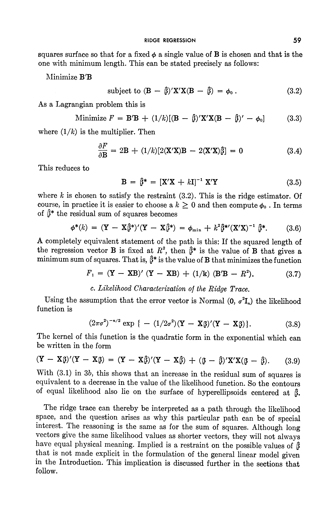

**As a Lagrangian problem this is**

**where (l/k) is the multiplier. Then**

**This reduces to**

**where k is chosen to satisfy the restraint (3.2). This is the ridge estimator. Of course, in practice it is easier to choose a k > 0 and then compute 0o . In terms of ~* the residual sum of squares becomes**

**c. Likelihood Characterization of the Ridge Trace.**

**Using the assumption that the error vector is Normal (0, o2I,,) the likelihood**

**The kernel of this function is the quadratic form in the exponential which can be written in the form**

**With (3.1) in 3b, this shows that an increase in the residual sum of squares is equivalent to a decrease in the value of the likelihood function. So the contours of equal likelihood also lie on the surface of hyperellipsoids centered at (.** **The ridge trace can thereby be interpreted as a path through the likelihood**

This content downloaded25 AM

All use subject to

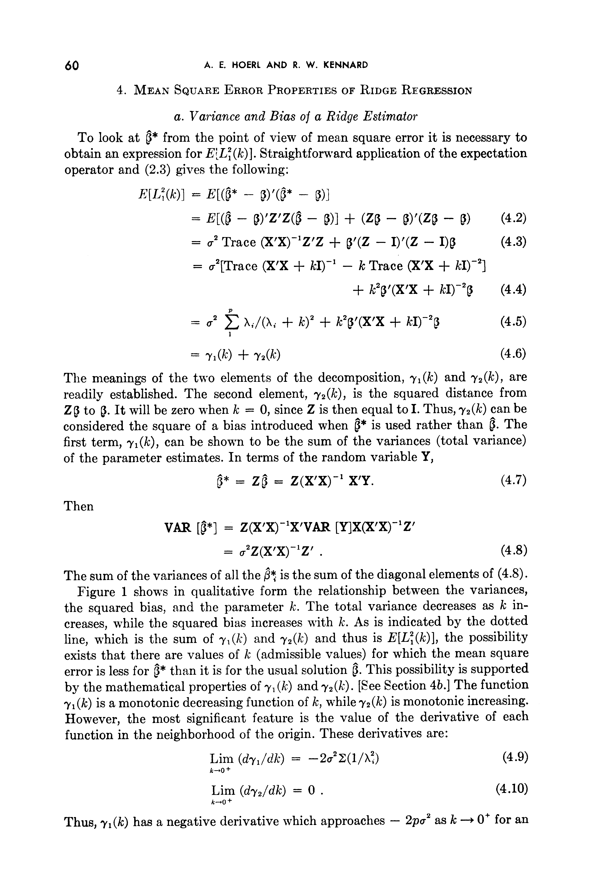

**A. E. HOERL AND R. W. KENNARD**

**4. MEAN SQUARE ERROR PROPERTIES OF RIDGE REGRESSION**

**a. Variance and Bias of a Ridge Estimator**

**To look at (* from the point of view of mean square error it is necessary to**

**= a2'Trace (X'X + kI)-1 - k Trace (X'X + kI)-2]**

**VAR [*]** **= Z(X'X)-1X'VAR [Y]X(X'X)-'Z'**

This content downloaded25 AM

All use subject to

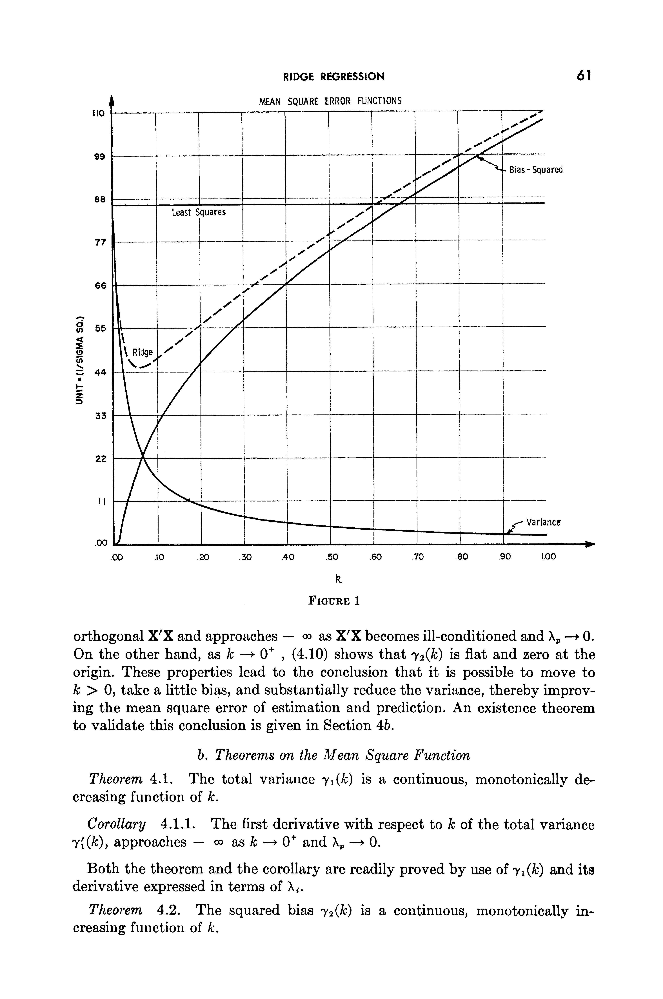

**RIDGE REGRESSION**

**MEAN SQUARE ERROR FUNCTIONS**

**b. Theorems on the Mean Square Function**

**creasing function of k.**

**Both the theorem and the corollary are readily proved by use of -y(k) and its derivative expressed in terms of Xi.**

**Theorem 4.2.** **The squared bias y2(k) is a conltinuous, monotonically in- creasing function of k.**

This content downloaded25 AM

All use subject to

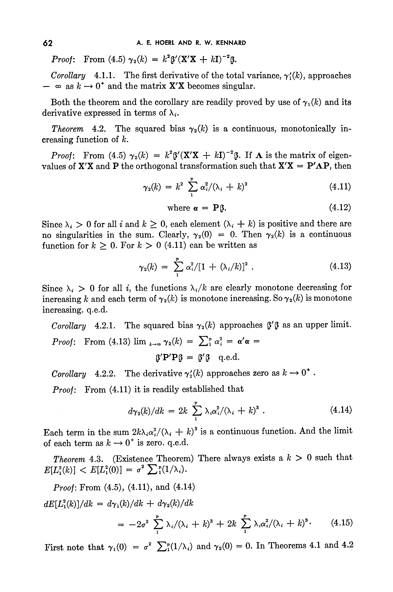

**A. E HOERL AND R. W. KENNARD**

**Both the theorem and the corollary are readily proved by use of i( (k) and its**

**derivative expressed in terms of Xi.**

**creasing function of k.**

**Each term in the sum 2kXia./(Xi + ck)3 is a continuous function. And the limit**

This content downloaded25 AM

All use subject to

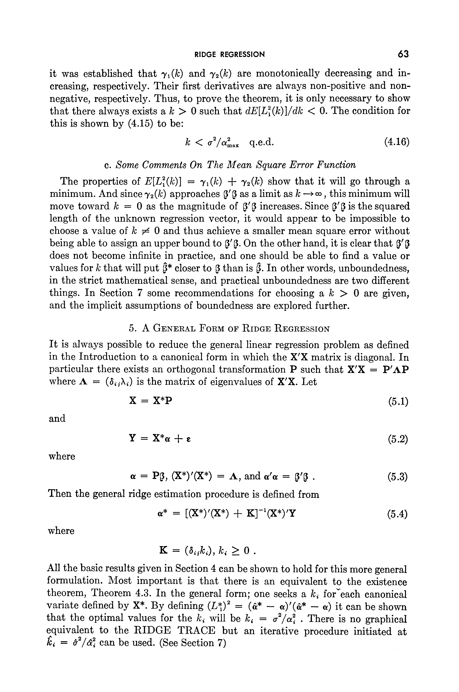

**c. Some Comments On The Mean Square Error Function**

**5. A GENERAL FORM OF RIDGE REGRESSION**

**Then the general ridge estimation procedure is defined from**

**K = (8jkj), k,** **0 .**

This content downloaded25 AM

All use subject to

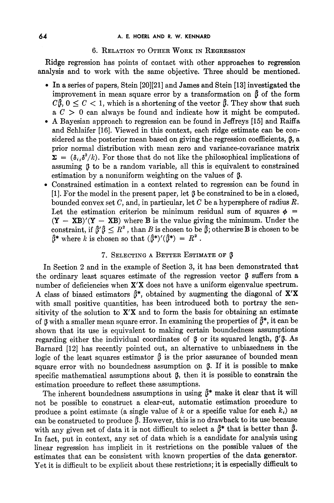

**A. E. HOERL AND R. W. KENNARD**

- **In a series of papers, Stein [20][21] and James and Stein [13] investigated the**
- **A Bayesian approach to regression can be found in Jeffreys [15] and Raiffa**
- **Constrained estimation in a context related to regression can be found in**
- **where k is chosen so that (R*)'(*) = R2 .**

**7. SELECTING A BETTErr ESTIMATE OF 3**

**In Section 2 and in the example of Section 3, it has been demonstrated that**

This content downloaded25 AM

All use subject to

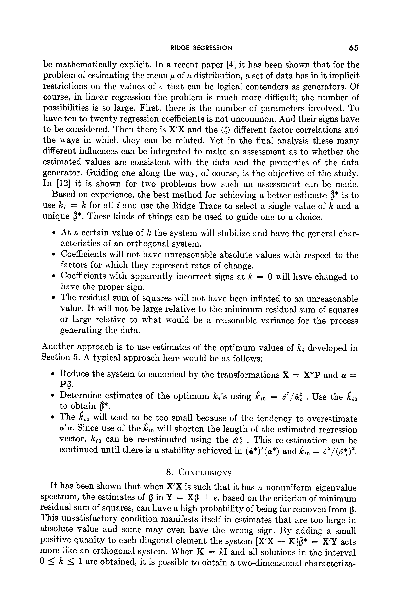

- **At a certain value of k the system will stabilize and have the general char- acteristics of an orthogonal system.**
- **Coefficients will not have unreasonable absolute values with respect to the** **factors for which they represent rates of change.**
- **Coefficients with apparently incorrect signs at k = 0 will have changed to have the proper sign.**
- **The residual sum of squares will not have been inflated to an unreasonable**

**value. It will not be large relative to the minimum residual sum of squares or large relative to what would be a reasonable variance for the process generating the data.**

**Another approach is to use estimates of the optimum values of ki developed in Section 5. A typical approach here would be as follows:**

- **Reduce the system to canonical by the transformations X = X*P and a =**

**to obtain ~*.**

- **The ki,o will tend to be too small because of the tendency to overestimate** **a'a. Since use of the kio will shorten the length of the estimated regression**

**It has been shown that when X'X is such that it has a nonuniform eigenvalue**

**residual sum of squares, can have a high probability of being far removed from 5. This unsatisfactory condition manifests itself in estimates that are too large in absolute value and some may even have the wrong sign. By adding a small positive quanity to each diagonal element the system [X'X + K] * = X'Y acts more like an orthogonal system. When K = kI and all solutions in the interval 0 < k < 1 are obtained, it is possible to obtain a two-dimensional characteriza-**

This content downloaded25 AM

All use subject to

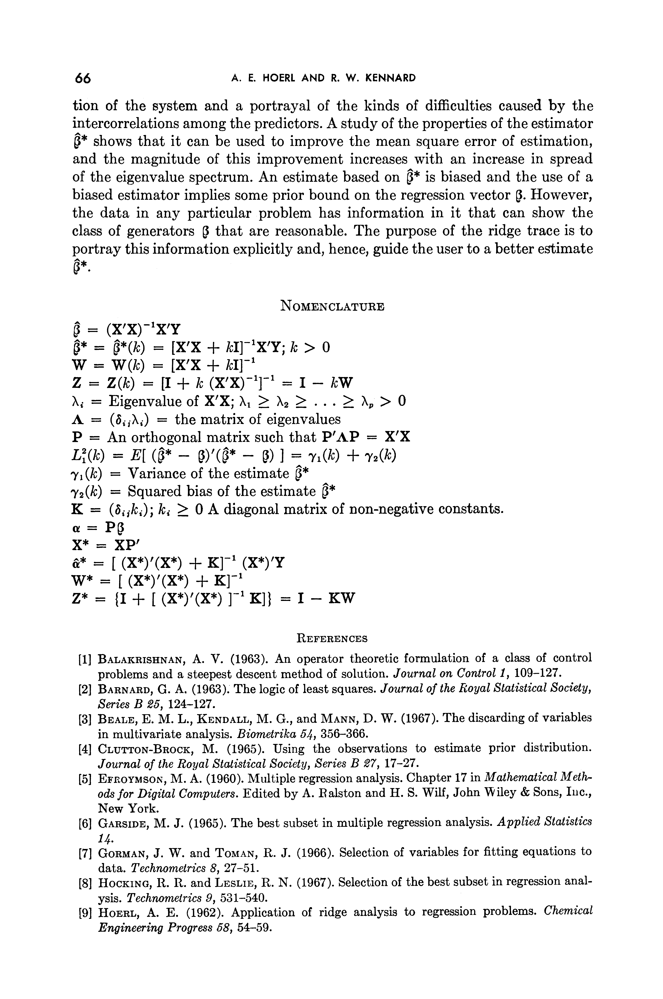

**A. E. HOERL AND R. W. KENNARD**

**tion of the system and a portrayal of the kinds of difficulties caused by the intercorrelations among the predictors. A study of the properties of the estimator**

**= (X'X)-1X'Y**

**Series B 25, 124-127.**

**[3] BEALE, E. M. L., KENDALL, M. G., and MANN, D. W. (1967). The discarding of variables**

**Journal of the Royal Statistical Society, Series B 27, 17-27.**

**data. Technometrics 8, 27-51.**

This content downloaded25 AM

All use subject to

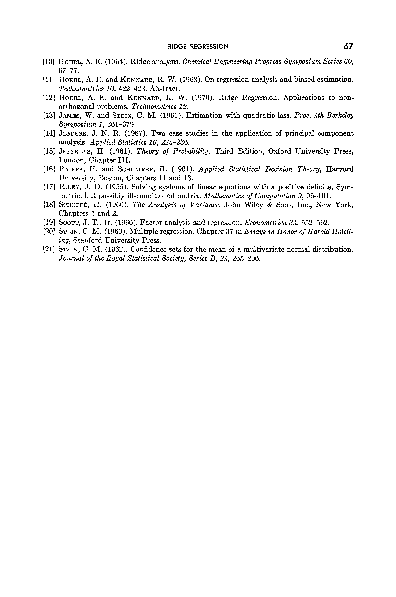

**Technometrics 10, 422-423. Abstract.**

**orthogonal problems. Technometrics 12.**

**Symposium 1, 361-379.**

**[14] JEFFERS, J. N. R. (1967). Two case studies in the application of principal component** **analysis. Applied Statistics 16, 225-236.**

**London, Chapter III.**

**University, Boston, Chapters 11 and 13.**

**[17] RILEY, J. D. (1955). Solving systems of linear equations with a positive definite, Sym-** **metric, but possibly ill-conditioned matrix. Mathematics of Computation 9, 96-101.**

**[18] SCHEFFE, H. (1960). The Analysis of Variance. John Wiley & Sons, Inc., New York, Chapters 1 and 2.**

**ing, Stanford University Press.**

**Journal of the Royal Statistical Society, Series B, 24, 265-296.**

This content downloaded25 AM

All use subject to